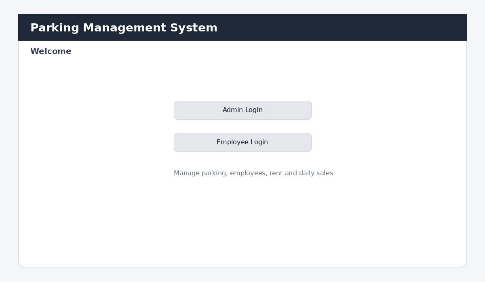
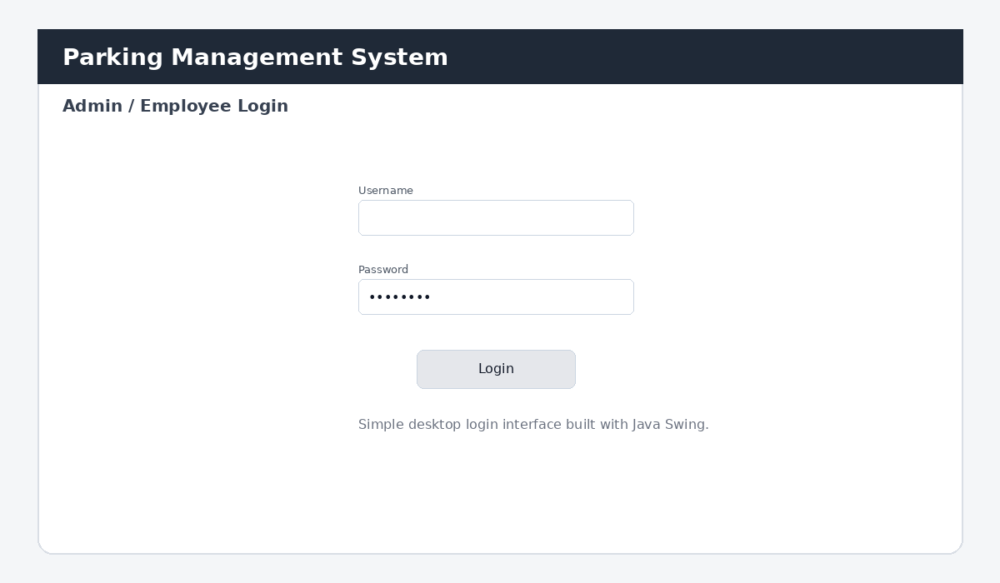
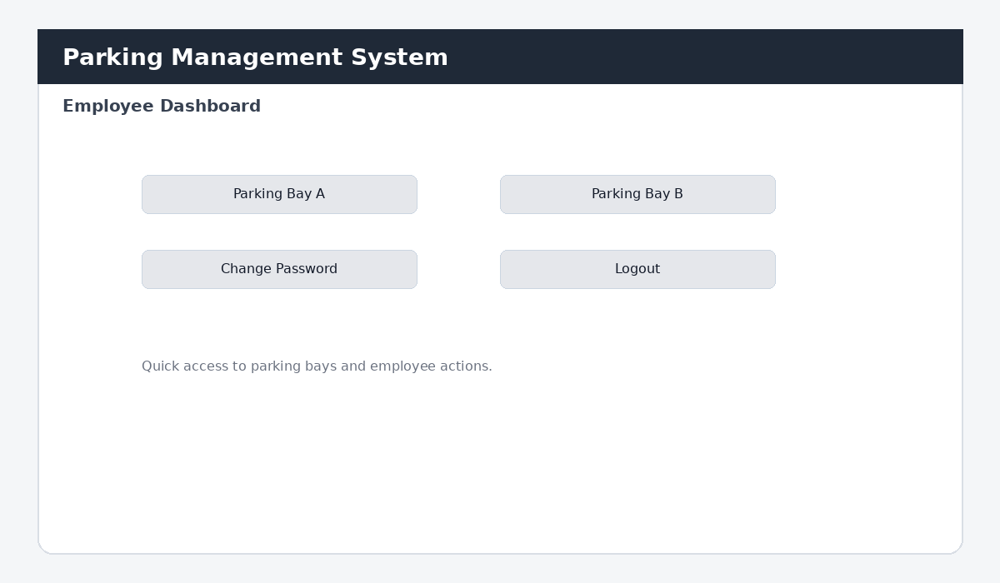
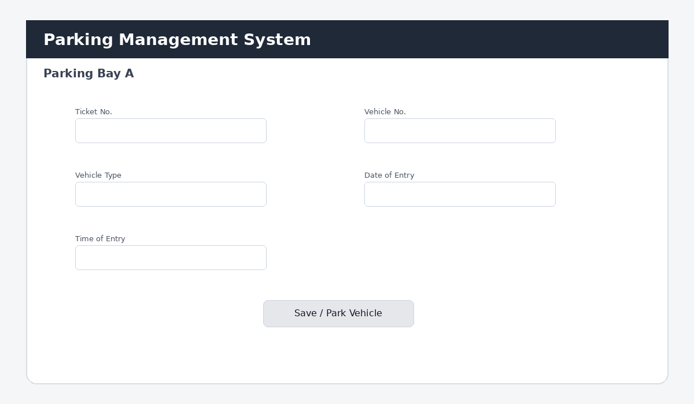
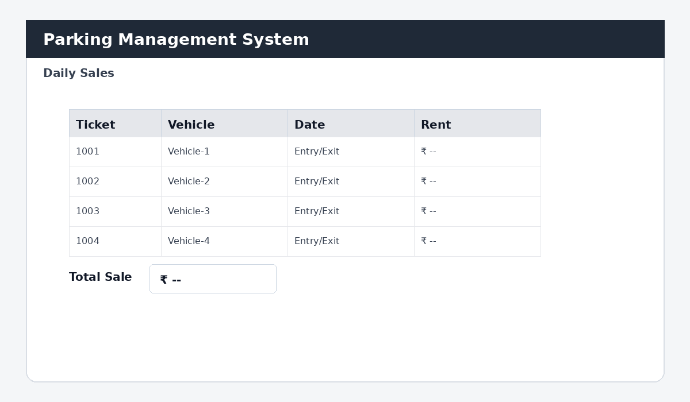

# Parking Management System 🚗

A Java Swing desktop application for managing a parking facility. The project includes separate admin and employee flows, parking-bay management, vehicle entry/exit records, parking rent management, employee management, and daily sales reporting.

## ✨ Features

- Admin and employee login screens
- Employee management
- Parking Bay A and Parking Bay B handling
- Vehicle entry and exit workflow
- Parking rent management
- Daily sales view
- Password-change screens
- Java Swing GUI with NetBeans form files

## 🖥️ Project UI

> The images below are clean UI previews based on the screens/components defined in the project. They are included to make the GitHub repository easier to understand at a glance.

### Welcome / Main Screen



The main screen provides quick access to the admin and employee login flows.

### Login



Separate login flow for authorized users.

### Employee Dashboard



The dashboard provides shortcuts to parking bays, password management and logout.

### Parking Bay



Parking-bay workflow for recording ticket, vehicle and entry details.

### Daily Sales



A simple view for reviewing parking transactions and total daily sales.

## 🛠️ Tech Stack

- **Java**
- **Java Swing**
- **NetBeans**
- **JDBC / database connectivity**

## 📁 Project Structure

```text
parking/
├── src/
│   ├── adminlogin.java
│   ├── adminhome.java
│   ├── employeelogin.java
│   ├── employeehome.java
│   ├── parkingbayA.java
│   ├── parkingbayB.java
│   ├── exitvehicle.java
│   ├── dailysale.java
│   ├── manageparkingrent.java
│   └── ...
├── nbproject/
├── build.xml
└── manifest.mf
```

## 🚀 Getting Started

1. Clone the repository.
2. Open the project in NetBeans.
3. Configure the required database connection for your environment.
4. Build the project.
5. Run the main application screen.

## 🔐 Security Note

This repository is intended to contain source code only. Personal names, phone numbers, SMS credentials and generated build artifacts have been removed from this cleaned copy.

## 📄 License

Add your preferred license here before publishing the repository.
