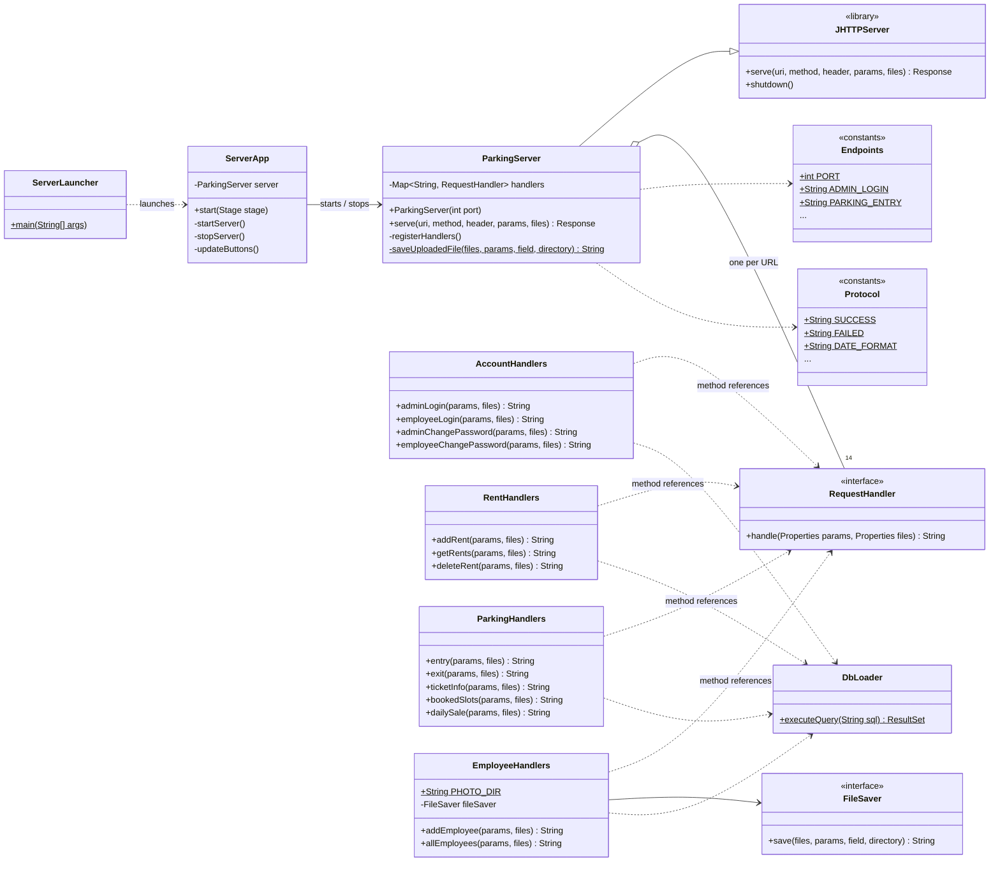
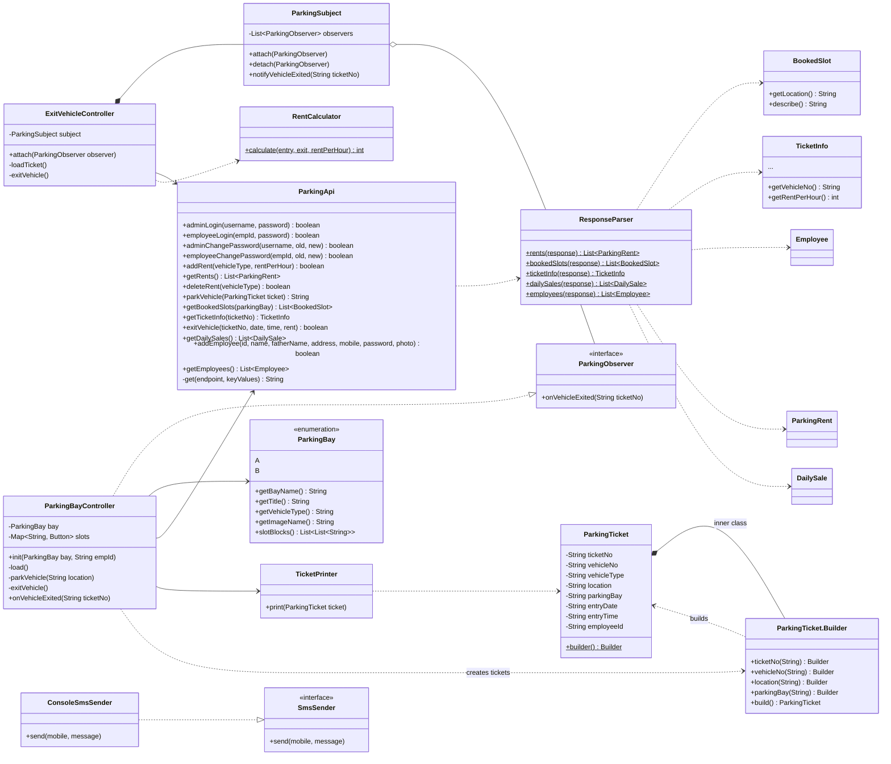
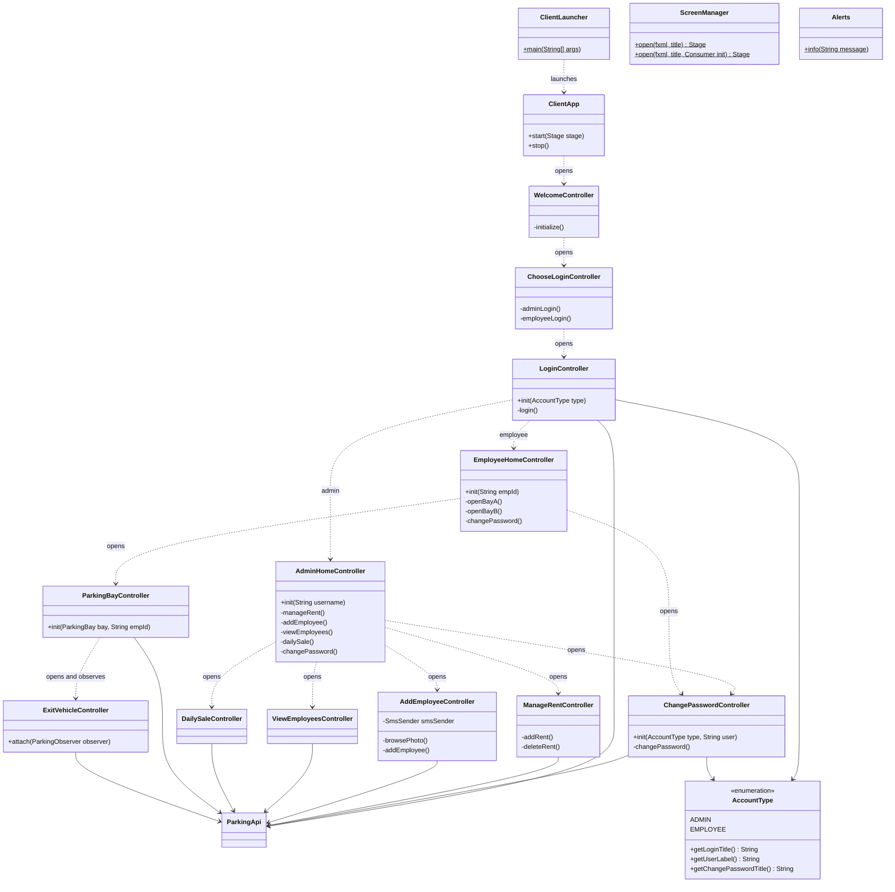

# Smart Parking Management System

A desktop application to manage a parking lot with two bays: **Bay A** for two wheelers (50 slots)
and **Bay B** for four wheelers (36 slots).

- **Admins** set the rent per hour of each vehicle type, add employees, see the employee list and see
  the daily sale.
- **Employees** park vehicles by clicking a free slot, which prints a ticket on a thermal printer.
  They exit vehicles with the ticket number, and the rent is calculated automatically.

The application has two parts:

- a **server** (JWebServer, port 8888) that reads and writes the MySQL database;
- a **JavaFX desktop client** that calls the server over HTTP.

This version is a refactoring of an older Swing application. It works the same way, but the code is
reorganised, it uses JavaFX instead of Swing, and it has unit tests.

## Requirements

- JDK 17 or newer (check with `java -version`)
- MySQL 8 running, with the user `root` and an **empty password**

Maven does not need to be installed: the project comes with `mvnw.cmd`, which downloads it.

## How to run

Open PowerShell in the project folder (the folder that contains `pom.xml`).

**1. Create the database** (only the first time):

```powershell
Get-Content db\schema.sql | mysql -uroot
```

This creates the database `db1`, its tables, and the admin account `admin` / `admin`.

**2. Start the server:**

```powershell
.\mvnw.cmd javafx:run@server
```

A small window opens. Click **start server** and leave it open.

**3. Start the application**, in a second PowerShell window in the same folder:

```powershell
.\mvnw.cmd javafx:run@client
```

**4. Log in** as admin with `admin` / `admin`. From the admin home you can set the rents and add
employees, then log in as an employee to park vehicles.

The first run takes a few minutes, because Maven downloads the libraries.

Good to know:

- When you add an employee, their login details (id and password) are printed in the PowerShell
  window of the application.
- Tickets are printed on a printer named "THERMAL Receipt Printer". Without that printer, nothing is
  printed, but the vehicle is still parked.
- Employee photos are saved in `src\content\`, inside the project folder.

## Tests

```powershell
.\mvnw.cmd test
```

There are 12 unit tests on the logic that does not need the database or the screens:

| Test class | What it checks |
|---|---|
| `RentCalculatorTest` | Rent is charged per full hour, with a minimum of one hour |
| `ResponseParserTest` | The server answers (rents, booked slots, ticket, daily sale) are read correctly; an invalid ticket gives no result; a bay with no exits yet counts as 0 |
| `ParkingBayTest` | Bay A has slots A1 to A50 in two blocks, and Bay B has 36 slots |
| `ParkingTicketTest` | The ticket builder adds the ticket number and refuses a ticket without a vehicle number |
| `ParkingSubjectTest` | Observers are notified when a vehicle exits, and stop being notified after they detach |

## Troubleshooting

| Problem | Fix |
|---|---|
| `mysql` is not recognized | MySQL is not on the PATH. Run `$env:Path += ";C:\Program Files\MySQL\MySQL Server 8.0\bin"` (change `8.0` to your version), then try again. |
| `Access denied for user 'root'` | root has a password. Remove it with `mysql -uroot -p -e "ALTER USER 'root'@'localhost' IDENTIFIED BY '';"` (it asks for the current password once). |
| `.\mvnw.cmd` is not recognized | You are not in the project folder. Go to the folder that contains `pom.xml`. |
| Error about the Java version | `java -version` must show 17 or newer. |
| "Login Failed" with `admin` / `admin` | The MySQL server is not running, or step 1 was not done. |
| Nothing happens when clicking in the application | The server is not started. Click **start server** in the server window first. |

## Project structure

```
src/main/java/com/parking
├── common/            Endpoints (URL names, port), Protocol (answers, separators, date formats)
├── server/
│   ├── ServerApp      start / stop window
│   ├── ParkingServer  routes each URL to its handler
│   ├── DbLoader       opens the database connection and runs a query
│   └── handler/       RequestHandler + one handler class per feature
│                      (accounts, rents, parking, employees)
└── client/
    ├── api/           ParkingApi (HTTP calls), ResponseParser (reads the answers)
    ├── model/         ParkingBay, ParkingTicket, BookedSlot, TicketInfo, Employee, ...
    ├── service/       RentCalculator, TicketPrinter, SmsSender
    ├── event/         ParkingObserver, ParkingSubject
    ├── util/          ScreenManager (opens a window from FXML), Alerts
    └── controller/    one controller per screen
src/main/resources/com/parking/client
├── views/*.fxml       the 12 screens
├── images/
└── style.css
src/test/java          unit tests
db/schema.sql          database tables
docs/uml/              UML class diagrams as images
```

## UML class diagrams

The diagrams below are written in Mermaid, so GitHub and most editors show them as pictures. The same
diagrams are also saved as images in `docs/uml/`.

How to read them: `--|>` inheritance, `..|>` implements an interface, `-->` uses (has a field),
`..>` depends on or opens, `o--` holds a collection of, `*--` owns. Underlined members are static.

### Server

The server window starts a `ParkingServer`, which keeps one `RequestHandler` per URL. The handler methods of the four feature classes are registered as method references, and they run their SQL through `DbLoader`.



Image: [`docs/uml/server.png`](docs/uml/server.png)

### Client: logic

`ParkingApi` makes the HTTP calls and `ResponseParser` turns the answers into model objects. The bay screen builds a `ParkingTicket` with its builder and prints it. It also observes the exit screen, which notifies it through `ParkingSubject` when a vehicle leaves.



Image: [`docs/uml/client-logic.png`](docs/uml/client-logic.png)

### Client: screens

Each screen has a controller and is opened through `ScreenManager`. Arrows with "opens" show the navigation between screens. Every screen that talks to the server uses `ParkingApi`, and messages are shown with `Alerts`.



Image: [`docs/uml/client-screens.png`](docs/uml/client-screens.png)


## What was refactored

- **Swing to JavaFX.** The screens are FXML files with one shared stylesheet, and each screen has
  its own controller.
- **Server split by feature.** The server used to be one long `if / else if` on the URL with all the
  SQL inside. Each URL now has its own handler method, grouped in four classes.
- **No duplicated screens.**
  - The two parking bay screens were near-copies of each other. One screen now handles both bays,
    using the `ParkingBay` enum, and the slot buttons are created in a loop.
  - The admin and employee login screens are now one screen, and so are the two change password
    screens.
- **No duplicated code.**
  - The server URL, the parsing of the answers and the ticket printing are each written in one
    place (`ParkingApi`, `ResponseParser`, `TicketPrinter`).
  - URL names, separators and date formats are shared constants.
- **Logic moved out of the screens.** The rent calculation and the parsing are plain classes, so
  they can be unit tested.
- **Unused server code removed** (sign up, profile, multiple upload and file streaming URLs).
- **Maven build** with the Maven wrapper. JWebServer is not on Maven Central, so it is kept in
  `local-repo/`.

## Design patterns used

Only where they solve a real problem in this code:

| Pattern | Where | Why |
|---|---|---|
| **Strategy** | `server/handler/RequestHandler`, used by `ParkingServer` | Each URL has its own handler, kept in a map. Adding a URL means adding one handler, not another branch of a long `if / else`. |
| **Observer** | `client/event/ParkingObserver`, `ParkingSubject`. The bay screen observes the exit screen. | When a vehicle exits, the bay screen that opened the exit window must refresh. The exit screen only notifies its observers, so it does not need to know which bay opened it. |
| **Builder** | `client/model/ParkingTicket.Builder` | A ticket has 8 text values, which are easy to mix up in a constructor. The builder names each one, and the same builder is reused to add the ticket number once the server returns it. |

## Bugs fixed during the refactoring

- The app did not compile, because the SMS class was missing. `SmsSender` is now an interface with a
  console implementation.
- Uploaded photos were saved with a hard-coded `\` path separator.
- The duplicate employee id check never worked.
- 10-digit mobile numbers were rejected, because they were parsed into an `int`.
- The daily sale screen crashed while vehicles of the day had not exited yet.
- "stop server" before "start server" crashed. The stop button is now disabled until the server
  runs.
- A server error sent no answer at all. It now answers `failed`.
- The welcome screen had no way to continue. It now opens the login choice.

## Known limitations

- Passwords are stored as plain text.
- The SQL queries are built by string concatenation.
- A new database connection is opened for every query.
- The ticket number is read with `select max(pid)`.
- The LOGOUT and DELETE (employee) buttons have no action yet.
- If the exit window is closed without exiting a vehicle, the bay window stays hidden. Reopen it from
  the employee home.
